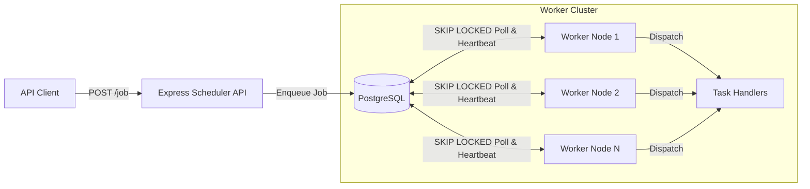
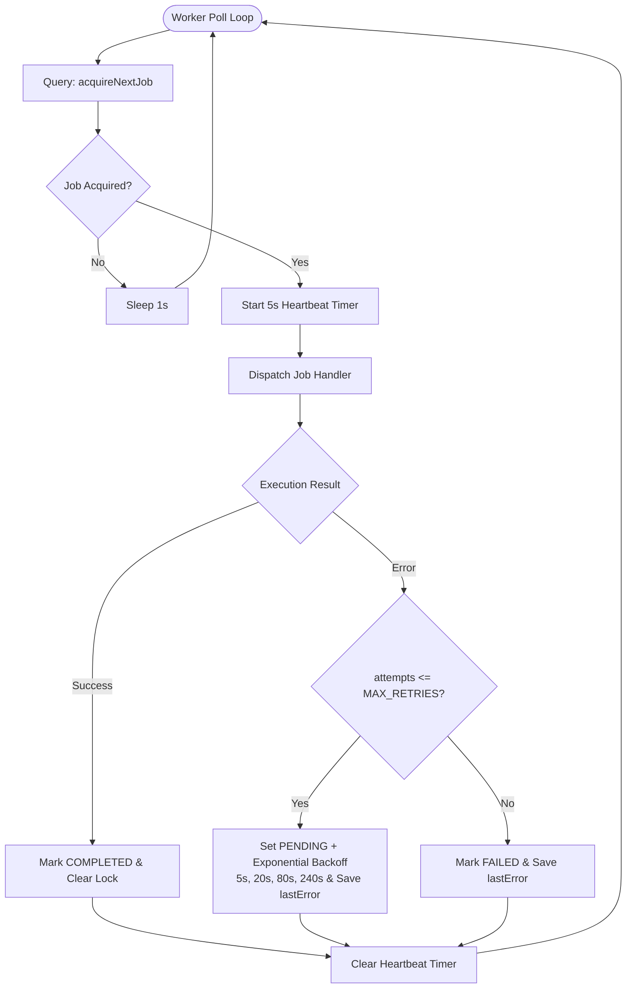

# Distributed Job Scheduler

A fault-tolerant background task execution system built with **TypeScript, Node.js, and PostgreSQL**.

Instead of introducing an external broker early on, this project implements a distributed task queue directly on top of PostgreSQL—handling concurrent worker polling, row-level lock contention, worker crash recovery, split-brain fencing, and exponential backoff at the SQL transactional level.

---

## System Architecture

The system follows a producer-consumer architecture coordinated through PostgreSQL row-level locks (`FOR UPDATE SKIP LOCKED`).



---

## Tech Stack

- **Runtime & Language**: Node.js, TypeScript (ESM Monorepo Workspaces)
- **Scheduler API**: Express 5, Zod (schema validation), Pino (structured JSON logging)
- **Database & ORM**: PostgreSQL 16, Prisma ORM (`@prisma/adapter-pg`)
- **Testing & CI**: Jest, Supertest, GitHub Actions
- **Infrastructure**: Docker & Docker Compose

---

## Core Mechanics

### 1. Lock-Free Worker Concurrency (`FOR UPDATE SKIP LOCKED`)
Multiple worker nodes poll PostgreSQL simultaneously. Using `FOR UPDATE SKIP LOCKED`, each worker locks only the single highest-priority row it claims and immediately skips rows locked by other active workers—preventing head-of-line blocking and duplicate execution.

```sql
WITH next_job AS (
    SELECT id
    FROM "Job"
    WHERE (status = 'PENDING' AND "availableAt" <= NOW())
       OR (status = 'RUNNING' AND "lockedAt" < NOW() - INTERVAL '30 seconds')
    ORDER BY "priority" DESC, "createdAt" ASC
    LIMIT 1
    FOR UPDATE SKIP LOCKED
)
UPDATE "Job"
SET
    status = 'RUNNING',
    "lockedBy" = $1, -- workerId
    "lockedAt" = NOW(),
    "attempts" = attempts + 1
FROM next_job
WHERE "Job".id = next_job.id
RETURNING "Job".*;
```

### 2. Heartbeats, Crash Recovery & Split-Brain Fencing
- **Heartbeats**: While executing a job, the worker updates `lockedAt = NOW()` every 5 seconds.
- **Stale Lock Recovery**: If a worker crashes mid-flight, its heartbeat stops. Any `RUNNING` job whose `lockedAt` is older than 30 seconds is automatically reclaimed by another worker inside the acquisition CTE.
- **Worker Ownership Fencing**: All state mutations (`COMPLETED`, `FAILED`, retry, and heartbeat pings) verify `WHERE id = $1 AND "lockedBy" = $2` so a stalled/zombie worker cannot overwrite a job that was reassigned to a healthy worker.

### 3. Worker Lifecycle & Exponential Backoff



---

## Database Schema & Indexing

Defined in [`packages/db/prisma/schema.prisma`](packages/db/prisma/schema.prisma):

| Column | Type | Description |
| :--- | :--- | :--- |
| `id` | `UUID` | Primary key |
| `type` | `String` | Handler key (`send_email`, `image_processing`) |
| `payload` | `JsonB` | Task arguments |
| `status` | `JobStatus` | `PENDING` \| `RUNNING` \| `COMPLETED` \| `FAILED` |
| `priority` | `Int` | Execution priority (higher runs first, default `0`) |
| `lockedBy` | `String?` | UUID of the worker currently holding the lock |
| `lockedAt` | `DateTime?` | Timestamp of lock acquisition or latest heartbeat |
| `attempts` | `Int` | Execution attempt counter |
| `lastError` | `String?` | Error message from the most recent failed attempt |
| `availableAt` | `DateTime` | Execution barrier for delayed jobs and retry backoff |

**Composite Indexes:**
- `idx_job_polling` on `(status, availableAt, priority DESC, createdAt ASC)` — Powers ready-job lookups and priority sorting via index scan.
- `idx_job_stale_locks` on `(status, lockedAt)` — Accelerates reclaiming expired locks from crashed workers.

---

## Performance & Benchmarks

Reproducible benchmark suite located in [`benchmarks/run-benchmarks.ts`](benchmarks/run-benchmarks.ts) (runnable via `npm run benchmark` against PostgreSQL 16).

### 1. Multi-Worker `SKIP LOCKED` Concurrency (2,000 Queued Jobs)
Measures pure lock-acquisition + completion throughput and lock contention across 1 to 16 concurrent workers polling PostgreSQL simultaneously:

| Concurrent Workers | Throughput (`jobs/sec`) | Lock Acquire `p50` | Lock Acquire `p95` | Lock Acquire `p99` | Jobs Claimed | Duplicate Executions |
| :--- | :--- | :--- | :--- | :--- | :--- | :--- |
| **1 Worker** | `695 jobs/s` | `0.65 ms` | `0.95 ms` | `1.90 ms` | `2,000 / 2,000` | `0 (0%)` |
| **4 Workers** | `1,490 jobs/s` | `1.13 ms` | `1.80 ms` | `4.59 ms` | `2,000 / 2,000` | `0 (0%)` |
| **8 Workers** | `1,967 jobs/s` | `1.65 ms` | `2.85 ms` | `5.91 ms` | `2,000 / 2,000` | `0 (0%)` |
| **16 Workers** | **`2,090 jobs/s`** | `3.45 ms` | **`4.96 ms`** | `6.71 ms` | `2,000 / 2,000` | **`0 (0%)`** |

### 2. Indexed vs. Unindexed Polling at Scale (100,000 Jobs in Table)
Evaluates `acquireNextJob` polling against a table populated with 100,000 jobs (`90k COMPLETED`, `5k FAILED`, `4k delayed PENDING`, `1k ready PENDING`) using `EXPLAIN (ANALYZE, BUFFERS)`:

| Configuration | Query Plan | Shared Buffers Read | SQL Execution Time | End-to-End Poll `p50` | End-to-End Poll `p95` |
| :--- | :--- | :--- | :--- | :--- | :--- |
| **Unindexed** | `Seq Scan` (99,000 rows filtered) | `1,826 buffers` | `5.94 ms` | `5.82 ms` | `7.48 ms` |
| **Composite Indexes** | `Bitmap Index Scan` | **`107 buffers` (-94.1%)** | **`1.35 ms` (-77.3%)** | **`1.76 ms` (3.3x faster)** | **`4.01 ms`** |

### 3. Crash Recovery & Split-Brain Fencing Integrity
Simulates 200 workers crashing mid-execution (`lockedAt` expired past the 30s heartbeat TTL), followed by healthy worker reclamation and late "zombie" worker completion attempts:
- **Stalled Jobs Reclaimed**: `200 / 200 (100%)` in `105.98 ms` (`0.53 ms/job`)
- **Zombie Worker Overwrites**: `0 / 200 (0%)` — all stale writes rejected by `WHERE id = $1 AND "lockedBy" = $2` fencing

### 4. Scheduler API Ingestion Load Test (`POST /job`)
1,000 HTTP `POST /job` requests across 20 concurrent connections (Express 5 + Zod schema validation + PostgreSQL insert):
- **Throughput**: **`2,282 req/sec`** (`1,000 / 1,000` `201 Created`)
- **Latency**: `p50: 6.76 ms` | `p95: 14.72 ms` | `p99: 56.02 ms`

---

## Quick Start

### Run with Docker Compose (Recommended)

Start PostgreSQL, the Scheduler API, and horizontally scaled worker nodes:

```bash
docker compose up --build --scale worker=3
```

- **Scheduler API**: `http://localhost:3000`
- **PostgreSQL**: `localhost:5432`

### Run Tests & Typecheck Locally

```bash
npm install
npm run db:generate
npm run typecheck
npm test
```

---

## API Reference

### 1. Enqueue a Job
`POST /job`

```json
{
  "type": "send_email",
  "payload": {
    "to": "user@example.com",
    "body": "Welcome aboard!"
  },
  "priority": 10,
  "availableAt": "2025-12-28T12:00:00Z"
}
```
> `priority` (integer) and `availableAt` (ISO-8601 timestamp) are optional.

**Response (`201 Created`)**:
```json
{
  "success": true,
  "message": "Job has been created successfully",
  "data": {
    "id": "4b63e144-8cd6-4993-8ef2-efc8f35212ab",
    "type": "send_email",
    "status": "PENDING"
  }
}
```

### 2. Get Job Status by ID
`GET /job/:id`

**Response (`200 OK`)**:
```json
{
  "success": true,
  "message": "Job fetched successfully",
  "data": {
    "id": "4b63e144-8cd6-4993-8ef2-efc8f35212ab",
    "type": "send_email",
    "payload": { "to": "user@example.com", "body": "Welcome aboard!" },
    "status": "COMPLETED",
    "priority": 10,
    "attempts": 1,
    "lastError": null
  }
}
```

### 3. List Jobs (Paginated)
`GET /job?limit=50&offset=0`

### 4. List Pending Jobs
`GET /job/pending`

### 5. System & Queue Metrics
`GET /job/stats`

**Response (`200 OK`)**:
```json
{
  "success": true,
  "message": "System stats fetched successfully",
  "data": {
    "queueDepth": {
      "PENDING": 10,
      "RUNNING": 2,
      "COMPLETED": 50
    },
    "activeWorkersCount": 2
  }
}
```

### 6. Health Check
`GET /health`
